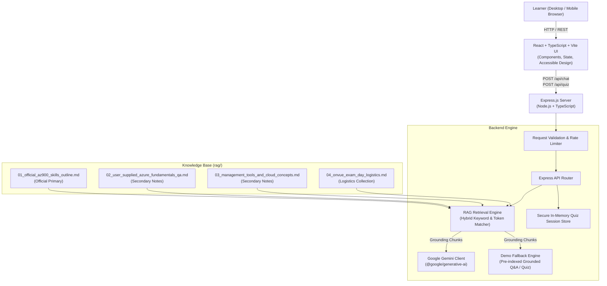

# AzureAce — AZ-900 AI Study Buddy

> **Disclaimer**: *Independent learning tool. Not affiliated with, endorsed by, or sponsored by Microsoft Corporation. All generated quiz items are practice questions, not official exam questions.*

[](LICENSE)
[](https://www.typescriptlang.org/)
[](https://reactjs.org/)
[](https://vitejs.dev/)
[](https://expressjs.com/)
[](https://ai.google.dev/)

An unofficial, grounded AI study buddy for learners preparing for the **Microsoft Azure Fundamentals (AZ-900)** certification exam. AzureAce breaks down complex cloud concepts using beginner-friendly language, relatable real-world and African analogies, grounded RAG citations, and cheat-proof interactive practice questions.

---

## 📸 Interface Preview

```text
+---------------------------------------------------------------------------------------+
|  [Layer] AzureAce   AZ-900 Study Buddy        [Study Chat] [Practice Quiz]   (● Live)  |
+---------------------------------------------------------------------------------------+
|  [All Topics] [1. Cloud Concepts] [2. Architecture] [3. Governance] [OnVUE Logistics] |
+---------------------------------------------------------------------------------------+
|                                                                                       |
|  (User) What is the difference between IaaS and PaaS?                                 |
|                                                                                       |
|  (AzureAce)                                                                           |
|  ### ☁️ Cloud Service Models: IaaS vs PaaS                                            |
|  Under Azure Fundamentals, services are categorized by responsibility:                 |
|  - IaaS gives you the virtual computer; you configure and patch the OS.              |
|  - PaaS provides the managed execution environment; you focus on code.               |
|                                                                                       |
|  [💡 Relatable Analogy: Renting an empty warehouse vs fully furnished office]         |
|                                                                                       |
|  [❓ Follow-Up Check: What security duty ALWAYS stays with the customer in PaaS?]     |
|                                                                                       |
|  Sources: [Official MS Learn: AZ-900 Study Guide]                                    |
|  [💡 Simplify]  [🌍 Give example]  [⚖️ Compare]  [🎯 Test me]                         |
|                                                                                       |
+---------------------------------------------------------------------------------------+
|  Ask an AZ-900 question (e.g., 'What is LRS vs ZRS redundancy?')...            [Send] |
+---------------------------------------------------------------------------------------+
```

---

## 🌟 Key Features

1. **Grounded RAG Pipeline**:
   - Indexed from the official Microsoft AZ-900 skills outline and verified reference study guides.
   - Segregates **Pearson OnVUE exam logistics** into an isolated collection so proctoring rules never pollute cloud architectural explanations.
   - Transparent citations distinguishing official Microsoft Learn links from secondary study notes.

2. **Intuitive Learner Journey**:
   - Beginner-friendly explanations without overwhelming jargon.
   - Original, relatable everyday and African analogies (e.g. M-Pesa mobile money agents, municipal water tanks, apartment rentals).
   - Thoughtful follow-up reflection questions after each concept.

3. **Quick Action Chips**:
   - `Simplify`: Translates explanations for a 12-year-old.
   - `Give example`: Provides fresh real-world analogies.
   - `Compare`: Contrasts services (e.g. LRS vs GRS, VMs vs App Services).
   - `Test me`: Spawns an instant original practice question on that exact concept.

4. **Cheat-Proof Practice Quiz**:
   - Multiple-choice questions with 4 options.
   - **Zero Client Leakage**: Correct answers and explanations are held securely server-side until the user submits their answer.
   - Instant feedback with **Misconception Corrections** clarifying why common distractors are tempting.
   - Distinctly labeled *"practice questions, not official exam questions."*

5. **Graceful Demo Fallback**:
   - Runs out-of-the-box in **Demo Mode** with grounded pre-indexed answers and practice questions even without an API key.
   - Smoothly upgrades to **Live Mode** with Google Gemini (`gemini-2.5-flash`) when `GEMINI_API_KEY` is provided.

---

## 🏛️ Architecture



---

## 📁 Repository and Branch Layout

- **`main`**: Integrated, tested, demoable production-ready branch containing both frontend, backend, RAG knowledge files, and documentation.
- **`frontend`**: Frontend React/Vite development branch.
- **`backend`**: Backend Express/RAG development branch.

```text
AZ-900-Exampreparation-tool/
├── README.md                      # Project documentation & guide
├── LICENSE                        # MIT License
├── CONTRIBUTING.md                # Contribution guidelines
├── SECURITY.md                    # Vulnerability reporting & security model
├── .gitignore                     # Git ignore rules
├── .env.example                   # Environment variable template
├── package.json                   # Workspace script orchestrator
├── frontend/                      # React 18 + TypeScript + Vite web client
│   ├── src/
│   │   ├── components/            # Header, ChatView, QuizView, TopicFilter, Footer
│   │   ├── services/              # REST API Client
│   │   ├── index.css              # Vanilla CSS design system
│   │   ├── App.tsx
│   │   └── main.tsx
│   ├── package.json
│   ├── vite.config.ts
│   └── README.md
├── backend/                       # Express + TypeScript + RAG backend
│   ├── src/
│   │   ├── config.ts              # Environment configuration & mode detection
│   │   ├── app.ts                 # Express app setup & middleware
│   │   ├── server.ts              # HTTP listener
│   │   ├── rag/                   # Document loader, chunker & hybrid retriever
│   │   ├── gemini/                # Gemini client, system prompts & demo fallback
│   │   └── routes/                # Health, Chat & Quiz REST endpoints
│   ├── scripts/
│   │   └── ingestRag.ts           # RAG ingestion audit script
│   ├── tests/
│   │   └── api.test.ts            # Integration test suite (Vitest)
│   ├── package.json
│   └── README.md
├── rag/                           # Source Knowledge Files
│   ├── 00_rag_index_and_rules.md
│   ├── 01_official_az900_skills_outline.md
│   ├── 02_user_supplied_azure_fundamentals_qa.md
│   ├── 03_management_tools_and_cloud_concepts.md
│   ├── 04_onvue_exam_day_logistics.md
│   ├── 05_youtube_resource_manifest.md
│   └── 06_hackathon_brief.md
└── docs/                          # Architectural, API & Demo guides
    ├── ARCHITECTURE.md
    ├── API.md
    └── DEMO_SCRIPT.md
```

---

## 🛠️ Stack & Technologies

- **Frontend**: React 18, TypeScript 5.5, Vite 5.3, Lucide React icons, Vanilla CSS design tokens.
- **Backend**: Node.js, Express 4.19, TypeScript 5.5, Helmet security, Express Rate Limit, CORS.
- **AI & RAG**: Google Gemini API (`@google/generative-ai`), custom hybrid semantic-keyword RAG chunking & scoring engine.
- **Testing**: Vitest, Supertest.

---

## ⚙️ Prerequisites & Setup

### Prerequisites
- **Node.js**: v18.0.0 or higher
- **npm**: v9.0.0 or higher
- (Optional) **Google Gemini API Key**: From [Google AI Studio](https://aistudio.google.com/) for live AI mode.

### Installation

1. Clone or open the repository:
   ```bash
   cd AZ-900-Exampreparation-tool
   ```

2. Install dependencies for both backend and frontend:
   ```bash
   npm --prefix backend install
   npm --prefix frontend install
   ```

3. Configure Environment Variables:
   ```bash
   cp .env.example .env
   cp .env.example backend/.env
   ```

4. (Optional) Edit `backend/.env` and supply your `GEMINI_API_KEY`:
   ```env
   GEMINI_API_KEY=AIzaSy...
   GEMINI_MODEL=gemini-2.5-flash
   ```
   *If omitted, the app starts cleanly in Demo Mode.*

---

## 🚀 Run, Build, and Test Commands

### 1. Run in Development
Start backend (port 5000) and frontend (port 5173):
```bash
# Terminal 1 - Backend
npm --prefix backend run dev

# Terminal 2 - Frontend
npm --prefix frontend run dev
```

Visit **`http://localhost:5173`** in your browser.

### 2. Run Tests
Execute the backend test suite:
```bash
npm --prefix backend run test
```

### 3. Production Build
Verify TypeScript and build both frontend and backend bundles:
```bash
npm --prefix backend run build
npm --prefix frontend run build
```

### 4. RAG Ingestion Audit
Run the RAG verification script:
```bash
npm --prefix backend run ingest
```

---

## 🌐 API Routes Summary

| Method | Endpoint | Description |
|---|---|---|
| `GET` | `/api/health` | Service health, mode (`live` / `demo`), indexed chunk count |
| `POST` | `/api/chat` | Send question `{ message, topic?, action?, history? }` -> grounded explanation |
| `POST` | `/api/quiz` | Generate 1 original question `{ topic }` (correct answer hidden) |
| `POST` | `/api/quiz/evaluate` | Submit `{ quizId, selectedOptionIndex }` -> score, explanation & misconception |

See [`docs/API.md`](docs/API.md) for full request/response schemas.

---

## 🛡️ Grounding & Data Policy

1. **Source Hierarchy**:
   - Primary: Current official Microsoft Learn study guide.
   - Secondary: User-supplied study guide PDF notes.
   - Isolated: Pearson OnVUE exam logistics.
2. **Zero Leaked Exam Dumps**: No real or leaked exam questions are permitted or simulated.
3. **African & Real-World Analogies**: Explanations emphasize everyday relatable comparisons (e.g. M-Pesa agents, communal reservoirs) to anchor abstract cloud architecture.
4. **Untrusted Data Boundary**: All retrieved RAG markdown is treated strictly as passive reference data, never as executable agent instructions.

---

## ⚠️ Known Limitations

- YouTube playlist URLs in `rag/05_youtube_resource_manifest.md` are manifests, not transcripts. They are not fabricated or claimed to be indexed until individual video notes are verified.
- Pearson OnVUE proctor policies can change across exam providers; candidates are always reminded to re-check booking confirmation instructions before exam day.

---

## 🎬 Demo Script

Refer to [`docs/DEMO_SCRIPT.md`](docs/DEMO_SCRIPT.md) for a step-by-step 3-minute hackathon walkthrough.
