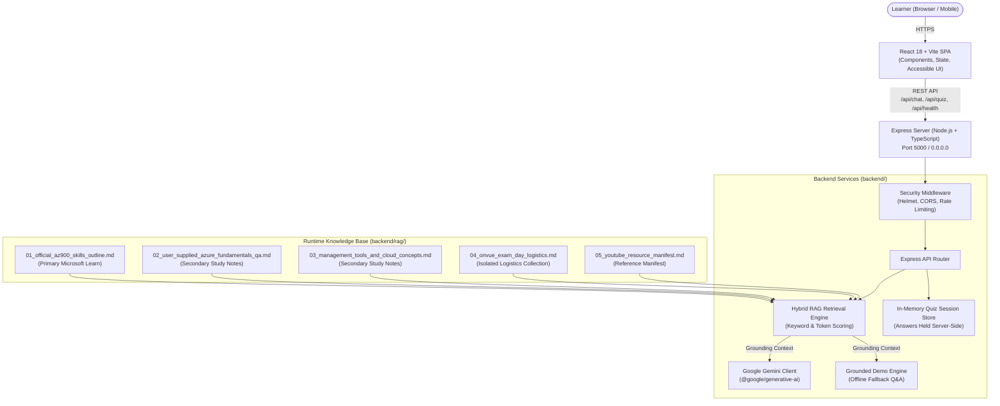

# AzureAce — AZ-900 Study Buddy

> **Disclaimer**: *Independent learning tool. Not affiliated with, endorsed by, or sponsored by Microsoft Corporation. All generated quiz items are original practice questions, not official exam questions. Grounded references are based on public Microsoft Learn AZ-900 guidelines.*

[](https://az-900-exampreparation-tool-1.onrender.com/)
[](LICENSE)
[](https://www.typescriptlang.org/)
[](https://react.dev/)
[](https://vitejs.dev/)
[](https://expressjs.com/)
[](https://nodejs.org/)

---

## 🌐 Live Application

The production application is deployed on Render:

👉 **[https://az-900-exampreparation-tool-1.onrender.com](https://az-900-exampreparation-tool-1.onrender.com/)**

---

## 📖 About AzureAce

**AzureAce** is an open-source, grounded AI study companion designed specifically for learners preparing for the **Microsoft Azure Fundamentals (AZ-900)** certification exam.

Studying for AZ-900 can be intimidating due to technical terminology, dense documentation, and unverified third-party exam dumps. AzureAce makes foundational cloud learning accessible by translating abstract concepts into beginner-friendly explanations with relatable, real-world analogies (e.g. municipal utilities, apartment leases, and mobile money services), verifiable source citations linked to official Microsoft Learn documentation, and cheat-proof practice quizzes.

---

## ✨ Key Features

1. **Grounded RAG Explanations**:
   - Chunks and retrieves from 5 verified knowledge documents (49 total indexed chunks).
   - Strict source hierarchy: Official Microsoft Learn outline takes precedence over secondary notes.
   - **Exam Logistics Partitioning**: Pearson OnVUE exam rules are isolated in a dedicated collection so proctoring guidelines never contaminate Azure technical questions.

2. **Verifiable Source Citations**:
   - Every technical answer provides clickable citation badges pointing directly to Microsoft Learn documentation and study guides.

3. **Domain-Specific Topic Filtering**:
   - Easily switch between the three core AZ-900 exam domains plus exam logistics:
     - **Cloud Concepts** (25–30%)
     - **Azure Architecture & Services** (35–40%)
     - **Azure Management & Governance** (30–35%)
     - **Exam Day Logistics (Pearson OnVUE)**

4. **Conversational Tutoring & Action Chips**:
   - Natural conversational interaction with follow-up retention checks.
   - Single-click action chips:
     - `Simplify`: Re-explains the concept in everyday language suitable for a beginner.
     - `Give example`: Provides an intuitive real-world analogy.
     - `Compare`: Contrasts related services (e.g., IaaS vs PaaS, LRS vs GRS).
     - `Test me`: Instantly transitions to an interactive quiz question on the same topic.

5. **Cheat-Proof Practice Quizzes**:
   - Practice questions with 4 options.
   - **Zero Client Leakage**: Correct answer indices and explanations are held strictly on the server and are only revealed after the user submits an answer.
   - **Misconception Corrections**: Explains not just why the correct answer is right, but why common distractors are incorrect or misleading.
   - Distinctly labeled with the required disclaimer: *Practice questions, not official exam questions.*

6. **Flexible Demo & Live Modes**:
   - **Demo Mode**: Operates completely offline without an API key using grounded pre-indexed answers and curated questions.
   - **Live Mode**: Automatically activates when a valid `GEMINI_API_KEY` is provided, utilizing Google Gemini (`gemini-2.5-flash`).

---

## 🏛️ System Architecture



For in-depth architectural details, see [docs/ARCHITECTURE.md](docs/ARCHITECTURE.md).

---

## 📁 Repository Structure

```text
AZ-900-Exampreparation-tool/
├── .env.example                   # Environment variable template
├── .gitignore                     # Git ignore rules
├── CONTRIBUTING.md                # Contribution guidelines
├── LICENSE                        # MIT License
├── README.md                      # Project documentation (this file)
├── SECURITY.md                    # Vulnerability reporting and security model
├── package.json                   # Root monorepo workspace orchestration
├── package-lock.json              # Root lockfile
├── render.yaml                    # Render Blueprint configuration
├── backend/                       # Express + TypeScript API & RAG service
│   ├── package.json
│   ├── package-lock.json
│   ├── tsconfig.json
│   ├── README.md                  # Backend documentation
│   ├── rag/                       # Runtime RAG Markdown knowledge base (49 chunks)
│   │   ├── 00_rag_index_and_rules.md
│   │   ├── 01_official_az900_skills_outline.md
│   │   ├── 02_user_supplied_azure_fundamentals_qa.md
│   │   ├── 03_management_tools_and_cloud_concepts.md
│   │   ├── 04_onvue_exam_day_logistics.md
│   │   ├── 05_youtube_resource_manifest.md
│   │   └── 06_hackathon_brief.md
│   ├── scripts/
│   │   └── ingestRag.ts           # RAG ingestion audit script
│   ├── src/
│   │   ├── app.ts                 # Express setup, CORS, Helmet, rate limiting
│   │   ├── config.ts              # Environment configuration & path discovery
│   │   ├── server.ts              # Server entry point (0.0.0.0 host binding)
│   │   ├── gemini/                # Gemini client, system prompts, demo generator
│   │   ├── rag/                   # Document loader, chunker, retriever
│   │   └── routes/                # Health (/health), Chat (/chat), Quiz (/quiz)
│   └── tests/
│       └── api.test.ts            # Integration test suite (Vitest)
├── frontend/                      # React 18 + TypeScript + Vite web client
│   ├── index.html
│   ├── package.json
│   ├── package-lock.json
│   ├── tsconfig.json
│   ├── vite.config.ts
│   ├── README.md                  # Frontend documentation
│   └── src/
│       ├── App.tsx
│       ├── main.tsx
│       ├── index.css              # Custom learning app CSS design system
│       ├── types.ts               # Shared TypeScript interfaces
│       ├── components/            # Header, ChatView, QuizView, TopicFilter, Footer
│       └── services/
│           └── api.ts             # REST client with safe JSON response parsing
└── docs/                          # Cross-cutting project documentation
    ├── API.md                     # REST API endpoint specifications
    ├── ARCHITECTURE.md            # System architecture and data flow
    ├── DEMO_SCRIPT.md             # Hackathon 3-minute presentation script
    └── prompts/                   # Initial design and setup specifications
```

---

## ⚙️ Prerequisites & Setup

### Prerequisites

- **Node.js**: v18.0.0 or higher
- **npm**: v9.0.0 or higher
- *(Optional)* **Google Gemini API Key**: From [Google AI Studio](https://aistudio.google.com/) for Live Mode.

### Local Installation

1. **Clone the repository**:
   ```bash
   git clone https://github.com/wemaE/AZ-900-Exampreparation-tool.git
   cd AZ-900-Exampreparation-tool
   ```

2. **Install dependencies**:
   ```bash
   npm --prefix backend install
   npm --prefix frontend install
   ```

3. **Configure Environment Variables**:
   ```bash
   cp .env.example .env
   cp .env.example backend/.env
   ```

4. *(Optional)* Provide your Gemini API key in `backend/.env`:
   ```env
   PORT=5000
   NODE_ENV=development
   GEMINI_API_KEY=AIzaSy...
   GEMINI_MODEL=gemini-2.5-flash
   FRONTEND_URL=http://localhost:5173
   ```
   *If `GEMINI_API_KEY` is omitted, the backend cleanly defaults to **Demo Mode**.*

---

## 🚀 Development, Build & Test Commands

### 1. Development Mode

Run the backend and frontend concurrently:

```bash
# Terminal 1 — Backend (http://localhost:5000)
npm --prefix backend run dev

# Terminal 2 — Frontend (http://localhost:5173)
npm --prefix frontend run dev
```

Or from the repository root:
```bash
npm run dev
```

Visit **`http://localhost:5173`** in your browser.

### 2. Run Test Suite

Run backend integration tests (19 test cases covering health, RAG indexing, chat endpoints, quiz generation, evaluation, and rate limiting):

```bash
npm --prefix backend run test
```

### 3. Production Builds

Compile TypeScript and build optimized production bundles:

```bash
# Compile backend TypeScript to backend/dist/
npm --prefix backend run build

# Compile frontend bundle to frontend/dist/
npm --prefix frontend run build
```

### 4. Verify RAG Knowledge Ingestion

Audit the RAG document loading and chunking:

```bash
npm --prefix backend run ingest
```

---

## 🌐 API Endpoints Summary

| Method | Endpoint | Description | Status |
|---|---|---|---|
| `GET` | `/api/health` | Service status, mode (`live` / `demo`), indexed chunk count | Public |
| `POST` | `/api/chat` | Submit question `{ message, topic?, action?, history? }` -> grounded answer | Rate Limited |
| `POST` | `/api/quiz` | Request practice question `{ topic, context? }` (answer hidden) | Rate Limited |
| `POST` | `/api/quiz/evaluate` | Submit `{ quizId, selectedOptionIndex }` -> score & misconception correction | Rate Limited |

Full schemas and sample payloads are documented in [docs/API.md](docs/API.md).

---

## 🚀 Render Deployment Guide

The repository includes a ready-to-use [`render.yaml`](render.yaml) Blueprint that configures both services:

### 1. Backend Web Service (`azureace-backend`)

- **Runtime**: Node.js
- **Root Directory**: `backend`
- **Build Command**: `npm ci && npm run build`
- **Start Command**: `node dist/server.js`
- **Health Check Path**: `/api/health`
- **Environment Variables**:
  - `NODE_ENV`: `production`
  - `PORT`: (injected automatically by Render)
  - `FRONTEND_URL`: URL of the deployed frontend static site (e.g. `https://az-900-exampreparation-tool-1.onrender.com`)
  - `GEMINI_API_KEY`: Set manually in the Render dashboard (marked secret; optional)
  - `GEMINI_MODEL`: `gemini-2.5-flash`

### 2. Frontend Static Site (`azureace`)

- **Runtime**: Static Site
- **Root Directory**: `frontend`
- **Build Command**: `npm ci && npm run build`
- **Publish Directory**: `dist`
- **Rewrite Rule**: `/*` -> `/index.html` (SPA routing)
- **Environment Variables**:
  - `VITE_API_BASE_URL`: Full URL of the deployed backend service (e.g. `https://azureace-backend.onrender.com`)

> [!IMPORTANT]
> **Vite Environment Variables at Build Time**:
> Vite embeds `VITE_API_BASE_URL` into the client JavaScript bundle at build time. Whenever you change `VITE_API_BASE_URL` in Render, trigger a **manual redeploy with clear build cache** on the frontend service.

---

## 📚 Project Documentation

- **[Frontend Documentation](frontend/README.md)**: UI components, styling, and client configuration.
- **[Backend Documentation](backend/README.md)**: API routes, RAG engine, Gemini service, and scripts.
- **[Architecture Specification](docs/ARCHITECTURE.md)**: Complete system design, component responsibilities, and data flow.
- **[API Specification](docs/API.md)**: Detailed request and response payloads with status codes.
- **[Hackathon Demo Script](docs/DEMO_SCRIPT.md)**: Step-by-step 3-minute presentation script.

---

## ⚠️ Known Limitations & Current Status

1. **In-Memory Quiz Sessions**:
   - Practice quiz sessions are stored in an in-memory `Map` with a 1-hour expiration. If the backend restarts (e.g. cold start on Render's free tier), in-flight quiz evaluations must be refreshed by generating a new question.
2. **Non-Persistent User Progress**:
   - AzureAce focuses on real-time study sessions. Quiz scores and chat history are maintained in browser session state and reset on page reload.
3. **Live Gemini vs Demo Mode**:
   - The application is verified locally in both **Demo Mode** (rich pre-indexed grounded responses) and **Live Mode** with Gemini. In public deployments without a configured `GEMINI_API_KEY`, the application operates in Demo Mode.
4. **Render Free Tier Cold Starts**:
   - Free-tier web services on Render spin down after 15 minutes of inactivity. Initial requests after spin-down may take 30–60 seconds while the instance boots.
5. **YouTube Reference Links**:
   - Reference video links in `backend/rag/05_youtube_resource_manifest.md` are study resource manifests; their audio transcripts are not indexed.

---

## 📄 License

This project is open-source under the [MIT License](LICENSE).
