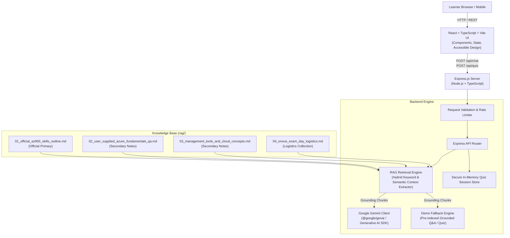

# AzureAce System Architecture

## Architectural Highlights

1. **Security & Privacy**:
   - The frontend never sees or receives API keys or unvetted secrets.
   - Quiz questions do not expose the correct answer or explanations to the client before answer submission, preventing client-side inspection cheating.

2. **RAG Knowledge Base & Strict Source Hierarchy**:
   - Primary: Official Microsoft Learn Study Guide (`01_official_az900_skills_outline.md`).
   - Secondary: User-supplied exam notes (`02` & `03`).
   - Isolated: Pearson OnVUE exam logistics (`04`) are partitioned so they never contaminate Azure technical questions.
   - Non-hallucinatory: In absence of grounded content, the system transparently indicates unverified status.

3. **Graceful Demo Fallback**:
   - When `GEMINI_API_KEY` is not configured, the app automatically runs in a clearly marked **Demo Mode** with grounded pre-compiled explanations and interactive quizzes.
